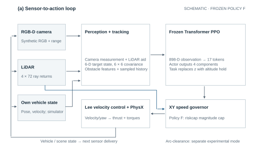
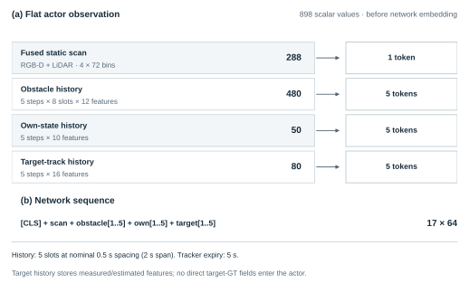

# MOTAR

**MOTAR: Moving Object Tracking And Rendezvous**<br>
*Reinforcement Learning for UAV Tracking and Close Approach in Random Obstacle Fields*

MOTAR studies moving-target rendezvous: an aerial pursuer that tracks another vehicle and closes in
on it among dense vertical obstacles. It measures how perception uncertainty, safety-filter
geometry, target-motion shift and the sensor set change learned policies. Two lines exist: the
historical RGB-D camera + LiDAR line around frozen Policy F, and, since November 2026,
a camera-only line for a real vehicle that carries no LiDAR. All policy evaluations are simulation-only.



**Main finding (historical line):** target-motion effects replicated under a bias-corrected
evaluation. Against the policy's training target motion, a static target scored **−5.37 pp**
capture, a constant-velocity target **−3.45 pp** and an obstacle-aware target **+1.35 pp**
(7 fresh seeds, 229,376 primary episodes). *Simulation only; no real-flight or state-of-the-art claim.*

## Why MOTAR?

MOTAR measures perception error on real footage, injects it into a frozen policy, and separately
varies safety geometry, target motion, rendering and the sensor set. This evidence sequence is not
a causal chain. Preregistrations and deviations are linked from [`docs/EVIDENCE.md`](docs/EVIDENCE.md);
negative, inconclusive and withdrawn results stay published.

## Current research: camera-only real-vehicle line

The real vehicle (user decision D-2026-11-06-1) has one forward OAK-D depth + colour camera, visual-inertial
odometry and PX4, and no LiDAR. Camera-only policies are a new lineage, trained and evaluated in simulation;
Policy F and the RGB-D + LiDAR contract still govern the historical results
([sensor contract](docs/SENSOR_CONTRACT.md), [camera-only evidence](docs/evidence/camonly_2026-11-04/README.md)).

- **Removing the LiDAR from Policy F** (zero-shot, out-of-distribution) raised crash by **+39.95 pp**;
  removing only the LiDAR outside the camera's view, **+39.25 pp**.
- **CAM-S3-E** compared the latest camera-only policy S3-W with its parent S2b-FT at 205 bars,
  3 seeds × 1,024 episodes per arm (percent of episodes):

| Policy | Capture | Crash | Bar contact | Target contact |
| --- | --- | --- | --- | --- |
| S2b-FT (parent) | 70.4 % | 28.5 % | 22.3 % | 6.0 % |
| S3-W | 72.6 % | 25.4 % | 15.7 % | 9.4 % |

  S3-W misses the ≤ 20 % crash bar: crash 25.4 %, one-sided Wilson 95 % [24.1, 26.7],
  **BAR_NOT_MET_POINT**. Against S2b-FT, crash changed by **−3.1 pp** (episode bootstrap 95 % [−5.3, −0.9];
  seed-block 95 % [−9.2, +3.0], 3 seeds) (SMALL): fewer bar
  contacts, more contacts with the target, status NO_IMPROVEMENT. The preregistered pointer is
  **STRUCTURAL_NEXT**: fine-tuning this lineage stops. Independent results review: PASS_WITH_LIMITS.
- **Vehicle runtime.** On 7 analytic CPU scenes, built from the runtime's own configuration, its observation and
  action match the training-side functions; review GO for a desk or hand-held shadow test only. No autonomous
  flight has been run or approved.
- **Outdoor hand-held depth** (one day, 3,107 frame-bins, offline). At an assumed 150 cm camera height, S2b native
  column rule: ground makes 38.7 % of frame-bins read nearer than 5 m (18.5–54.8 % for 130–170 cm); sky false-near
  2.67 % (heuristic sky mask). S3-W sector rule: 36.8 % and 2.90 %. Ground handling blocks any flight; an earlier
  synthetic outdoor profile got review r3 FAIL (2026-11-18), no outdoor GO.

All numbers above are read from [`docs/status/data/camonly-status.json`](docs/status/data/camonly-status.json),
which `tools/build_camonly_public_status.py` builds from the committed records.

## Key Results

| Question | Result | Status and limit |
| --- | --- | --- |
| Target motion vs the training target | static **−5.37 pp** · constant velocity **−3.45 pp** · obstacle-aware **+1.35 pp** capture | Independent bias-corrected replication, policy F, 7 fresh seeds; all three contrasts replicated. The obstacle-aware gain was not uniform at high density |
| Measured perception error → policy | **−4.57 pp** capture, 95 % CI [−6.32, −2.82] | Policy F; episode-level interval from two evaluation seeds at one density; one injector |
| Readaptation under that error | **+0.73 pp**, 95 % CI [−1.04, +2.50] | **INCONCLUSIVE**: no net benefit established; 3 training seeds |
| Safety-filter geometry | **−1.4903 pp** crash; seed-level 95 % CI [−2.42, −0.57] | Policy F, 3 evaluation seeds; lower in 15/15 seed × density cells, which are not independent replicates. Configured contrast; not a safety guarantee |
| Observation contract | **−48.967 pp** capture | **MATERIAL_LOSS**; causality **NOT_TESTED**; policy R (a different checkpoint), 3 evaluation seeds |
| Perception range error on real footage | **6.2 %** median of 9 block medians | One flight (9 blocks of 15 s; 3,107 frames, not independent samples); apparent-size proxy |

pp = percentage points. Policy F (ep25000 + riskcap) carries these results except the observation contract
(policy R, ref5in D1 ep1900). No external result is compared numerically: Class A matched comparisons = 0.

## System



In the historical line a forward RGB-D camera and a LiDAR feed perception. The flat 898-D actor observation
is assembled first, then embedded into 17 tokens inside the frozen Transformer PPO network; an XY speed
filter caps the planar request before the Lee velocity controller. The camera-only line keeps the 898-D layout
but fills the scan from the camera alone. Ground-truth target state never enters any actor observation.
Details and source paths: [`ARCHITECTURE.md`](ARCHITECTURE.md); figures with source verification:
[figure atlas](https://joshualikaist.github.io/MOTAR/status/figures.html).

## Target-motion replication

**REPLICATED.** 7 fresh evaluation seeds, 4 arms × 4 densities, 112 cells × 2,048 primary episodes =
229,376 primary episodes, no PPO training. H is the historical training motion; E0 static; E1 bounded
constant velocity; E2 bounded obstacle-aware motion. Capture: H 87.76% · E0 82.39% · E1 84.32% · E2 89.12%.

| Capture contrast (pp), BCa95 | Original n=3: legacy window | Replication n=7: per-environment quota |
| --- | --- | --- |
| E0 − H | −3.58 [−4.04, −3.29] | −5.37 [−5.78, −4.85] |
| E1 − H | −2.82 [−3.53, −2.44] | −3.45 [−3.79, −3.11] |
| E2 − H | +1.33 [+1.15, +1.50] | +1.35 [+1.07, +1.87] |

Each contrast has 7/7 seeds in the same direction (exact p = 0.015625, Holm-adjusted p = 0.046875, the
resolution boundary of a seven-seed sign-flip design), so effect sizes and intervals are reported with the
tests. E2's gain was not uniform at 160 and 205 bars; density-specific analyses are exploratory. The original
campaign, the bias discovery and the replication are separate stages and are never pooled.
[Full record](results/target_motion_replication_7seed/README.md) ·
[Analysis](results/target_motion_replication_7seed/analysis.json).

## Research Extension — BOIA (October 2026)

BOIA studies when to keep Frozen F tracking and when to propose active reacquisition after observation
loss in the historical RGB-D Camera + LiDAR line. First acquisition is outside its scope. Evaluation is shadow-only: proposals do not command the
vehicle. Q01-V2 parity is qualified; Q02-A passed review with identity limitations; Q02-B and Q03 failed
independent review and are on HOLD; Q04 is design only (G5 HOLD). Actual occlusion accuracy is NOT VALIDATED and
persistent same-target identity is NOT CONFIRMED. The latest research PUBLIC_CPU receipt is 3,177 run,
0 failures, 10 skips and 4 errors (aggregate FAIL). [Progress and limitations](docs/research/boia-progress.md) ·
[Source-bound evidence](docs/status/data/boia-progress.json) · [Website section](docs/status/index.html#boia).

## Repository Structure

| Path | Contents |
| --- | --- |
| `aerial_gym/` | Simulator and the MOTAR task: environment, sensors, perception, policy, safety filter, control |
| `tools/` | Public tools (environment doctor, renderer, figure and document builders), experiment and runtime scripts |
| `tests/` | Contract, evidence and documentation guards |
| `results/` | One immutable folder per experiment: receipts, raw counts, summaries, VOID runs |
| `docs/` | Evidence, decisions, preregistrations, operations, history; the site in `docs/status/` |
| `ros2/` | The camera-only onboard runtime package (shadow testing only) |

## Quick Start

The supported public path is CPU-only: Linux x86-64, Python 3.8, Git and a new virtual environment. It needs
no GPU and no Isaac Gym, and runs no policy.

```bash
git clone https://github.com/joshualikaist/MOTAR-public.git MOTAR && cd MOTAR
# create and activate the isolated CPU environment: docs/renderer_cpu_quickstart_2026-09-12.md
export PYTHONNOUSERSITE=1 CUDA_VISIBLE_DEVICES=''
python -B tools/motar_doctor.py --profile renderer-cpu
python -B tools/run_renderer_validation.py --device cpu --seed 0 --num-scenes 1 \
  --width 160 --height 120 --frames 2 --output /tmp/motar-smoke-new
python -B -m unittest discover -s tests -p 'test_public*.py'
```

The smoke test renders generic boxes; it is not an experiment verdict. Recorded results are verified from
their receipts rather than re-run ([`docs/REPRODUCIBILITY.md`](docs/REPRODUCIBILITY.md)). Simulator runs need
a GPU and Isaac Gym Preview 4, which NVIDIA distributes and which cannot be redistributed here;
cross-machine bitwise reproducibility has not been established.

## Research Evidence

Every result, its interval, its record and its limit: [**`docs/EVIDENCE.md`**](docs/EVIDENCE.md). Experiment
families and their lineage: [`docs/EXPERIMENTS.md`](docs/EXPERIMENTS.md). The public site is in
[`docs/status/`](docs/status/index.html); historical figures are in the
[figure overview](docs/results_overview_2026-09-12.md). Paper draft (historical line):
`paper/MOTAR_draft_2026-09-26.md`; its Word copy and the overview deck are kept locally and not published.

## Documentation

- [`PROJECT.md`](PROJECT.md): purpose, questions, scope and phase.
- [`ARCHITECTURE.md`](ARCHITECTURE.md): how the system connects and which directories may change.
- [`docs/PROJECT_STATE.md`](docs/PROJECT_STATE.md) and [`docs/DECISIONS.md`](docs/DECISIONS.md): current state
  and the user's standing decisions.
- [`docs/REPRODUCIBILITY.md`](docs/REPRODUCIBILITY.md) and [`docs/OPERATIONS.md`](docs/OPERATIONS.md):
  environments, verification and run rules.
- [`docs/HISTORY.md`](docs/HISTORY.md): milestones and the negative record.
- [`AGENTS.md`](AGENTS.md) and [`DESIGN_SYSTEM.md`](DESIGN_SYSTEM.md): rules for contributors, the site and
  the figures.

## Limitations

> MOTAR is **simulation-only** research on moving-target rendezvous (tracking and close approach in
> a simulated obstacle field). It makes **no real-flight validation claim**, no sim-to-real claim and
> no state-of-the-art claim, and it provides no deployment instructions. The historical experiments
> were framed as interception; their metric names (`capture`, `crash`) keep their original meaning,
> and "rendezvous" does not reinterpret them. Each effect holds only inside its recorded contract:
> checkpoint, arena, densities and seeds. Readaptation is INCONCLUSIVE, the D8b cause is NOT_TESTED,
> and persistent target identity and metric range are BLOCKED by missing ground truth.

The camera-only line has not flown autonomously; its outdoor evidence is hand-held depth recordings, and its
simulated target and depth artefacts are models. Class A matched external benchmarks = 0. The minimum-distance
metric is **WITHHELD_SEMANTIC_MISMATCH**. Several raw datasets and artifacts are not distributed in normal Git.

## Citation and license

Cite the software with [`CITATION.cff`](CITATION.cff). No MOTAR paper has been published, and no
author identifier is invented. Cite the upstream software and datasets used by an experiment separately.

**License.** Original code is offered under the repository's [BSD-3-Clause notice](LICENSE), subject to the
retained upstream notices. This does not cover every data file or dependency; see the
[third-party inventory](THIRD_PARTY_LICENSES.md). ETH ds5 images are not redistributed and must be
obtained separately under CC BY-NC-SA 4.0 ([external data](docs/external_data/ETH_DS5.md)).

MOTAR derives from [Aerial Gym Simulator](https://github.com/ntnu-arl/aerial_gym_simulator) and
acknowledges NavRL, rl_games, NVIDIA Warp, urdfpy, trimesh and the cited dataset authors. Acknowledgement does not imply endorsement.
