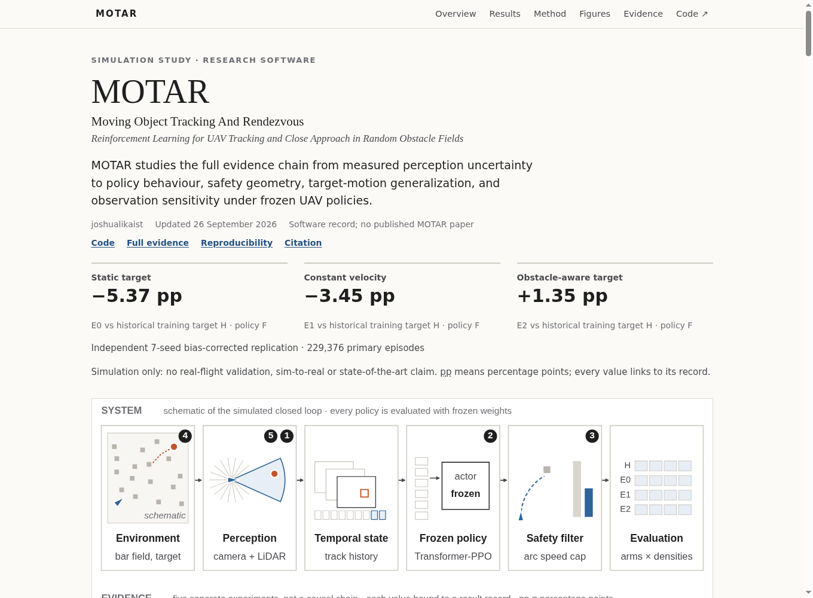
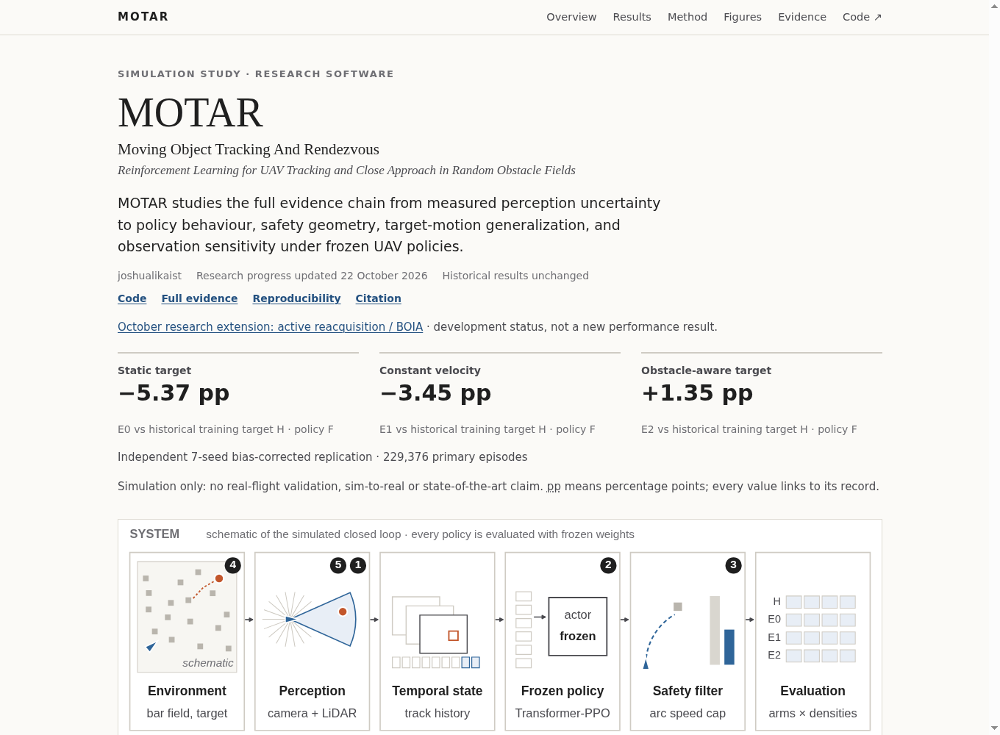
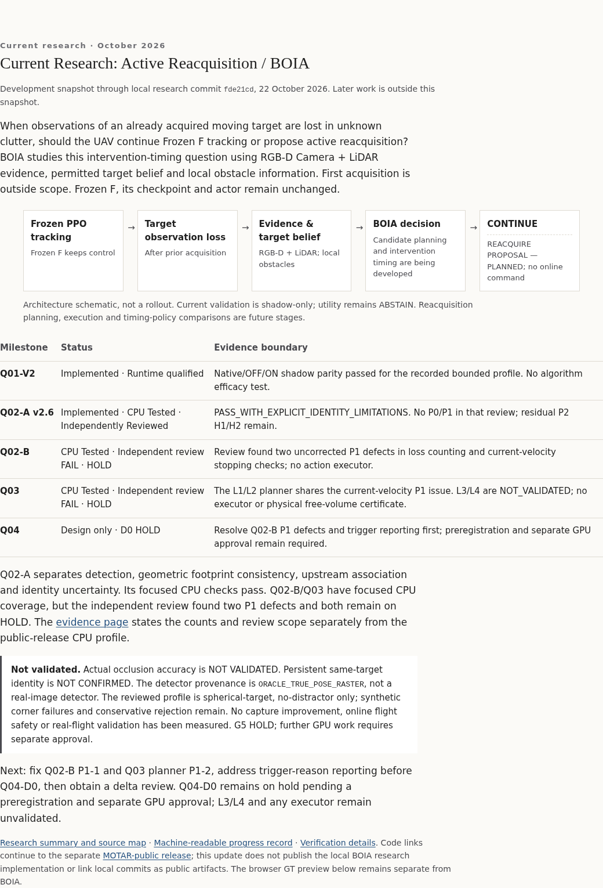
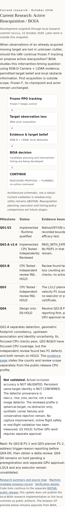

# Website visual preview

These are software-rendered browser screenshots, not simulator or policy output. The comparison
uses the public repository base commit 2da5b12 as the before state and the deployment candidate
as the after state. Desktop, tablet and mobile checks cover both project and evidence pages.

| Before: current public project page | After: BOIA progress added |
| --- | --- |
|  |  |

## Added BOIA section — desktop

## Added BOIA section — mobile

The flow becomes vertical. The milestone table scrolls inside its own focusable region; the
page body does not scroll horizontally.

The browser receipt records 12 PASS checks across two pages and three viewport sizes.
For an interactive local preview, run from this worktree:

    python3 -m http.server 8000 --bind 127.0.0.1 --directory docs

Open /status/index.html#boia and /status/evidence.html#boia. This local command does not
publish the site or execute research code.
