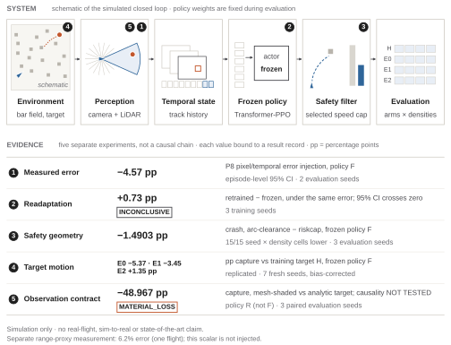
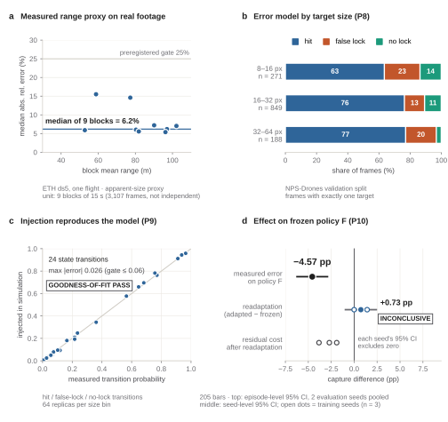
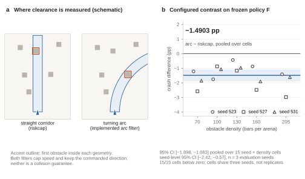
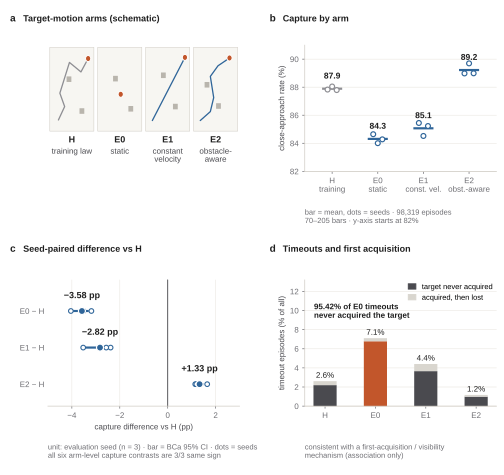
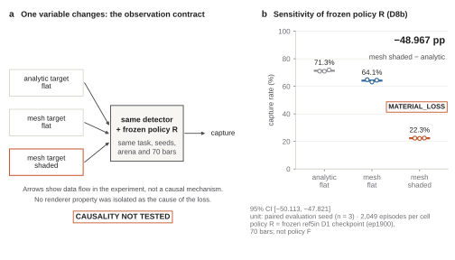
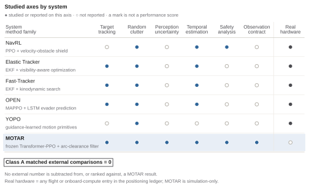

# MOTAR: Independent Replication of Target-Motion Effects in UAV Close-Approach Simulation

**Moving Object Tracking And Rendezvous**

Minseok Lee and Hyondong Oh · Department of Mechanical Engineering, KAIST

Research draft · 26 September 2026 · Evidence baseline: `2da5b12c1954ee768fcba59d1fb1fb9c78f7d536`

## Abstract

MOTAR studies the evidence chain linking measured perception uncertainty, policy sensitivity, safety-filter geometry, target-motion distribution shift, and observation-contract changes in UAV close-approach simulation. All policy-performance evidence is simulation-only; real imagery is used for offline perception measurement. A held-out range proxy has 6.2% median absolute relative error across nine blocks from one flight. Separately measured pixel and temporal detector errors reduce frozen-policy capture by 4.57 percentage points (pp), while readaptation remains inconclusive. A configured arc-clearance filter reduces crash by 1.4903 pp relative to riskcap; this comparison changes both clearance geometry and the speed-limiting law. Our central result is an independent replication of target-motion effects using seven fresh evaluation seeds, 112 cells, and 229,376 primary episodes selected by a corrected per-environment quota protocol. Relative to historical training-lineage motion, static and bounded constant-velocity targets reduce capture by 5.37 and 3.45 pp, respectively; bounded obstacle-aware waypoint motion produces a positive aggregate contrast of 1.35 pp. All three preregistered directional contrasts replicate, although the obstacle-aware direction is not uniform at the two highest densities. On a different frozen checkpoint, an observation-contract change produces −48.967 pp capture, recorded as MATERIAL_LOSS with causality NOT_TESTED. The study preserves negative and inconclusive outcomes, separates policy lineages and inferential units, and retains the original three-seed campaign without pooling it into the replication. It establishes bounded sensitivity results, not real-flight readiness, universal target difficulty, or superiority over external systems.

**Keywords:** UAV tracking; close approach; frozen-policy evaluation; perception uncertainty; target-motion distribution shift; independent replication.

## 1. Introduction

Tracking and closely approaching a moving object in clutter require several coupled capabilities. The vehicle must acquire and retain the target in its observations, command feasible motion, and avoid obstacles while the target changes position. A policy can score differently because its perception changes, its motion command is filtered differently, or the target follows a different distribution. A success rate alone does not distinguish these explanations. Evaluation is also a measurement procedure: when parallel environments finish episodes at different rates, the stopping rule can affect which episodes contribute to the reported rate.

MOTAR asks how these assumptions affect already-trained UAV policies. It evaluates a simulated quadrotor with a camera-derived target track, LiDAR obstacle observations, a temporal policy, and a downstream speed filter. The actor has no privileged ground-truth target input. Instead of proposing a new learning algorithm, we organize source-bound measurements around specific changes to the evaluation contract. An evidence chain here means a sequence of related research questions; it does not mean that every reported effect causally produces the next one.

The strongest current evidence concerns target motion. The original three-seed campaign found lower capture for static and constant-velocity targets than for the historical motion law used by the policy's training lineage, and a small positive difference for obstacle-aware motion. A subsequent instrumentation audit identified a pooled-stopping-window issue. An independently preregistered evaluation then used seven fresh seeds and an equal per-environment episode quota. The three directional effects reproduced under that protocol. This sequence distinguishes an original finding, a measurement audit, and a confirmatory replication rather than retroactively assigning the corrected estimator to the original campaign.

The broader programme adds context without turning separate studies into one causal hierarchy. Real imagery supports a range-proxy measurement and, in a separate branch, a pixel/temporal detector-error model. Injecting the latter into simulation incurs a measurable policy cost; readaptation does not establish a net benefit. Configured safety-filter comparisons expose trade-offs between crash, capture, and timeout. A rendering treatment affects another frozen policy substantially, but the cause of that loss has not been isolated. These boundaries are part of the result, rather than qualifications deferred until the end.

Our contributions are:

1. **Independently replicated target-motion sensitivity.** Across four motion contracts, seven fresh evaluation seeds reproduce capture contrasts of −5.37 pp for static, −3.45 pp for bounded constant velocity, and +1.35 pp for bounded obstacle-aware motion relative to the historical reference. The corrected protocol yields 112 cells and 229,376 primary episodes.
2. **Separated perception measurements and policy effects.** We report a 6.2% held-out range-proxy error from one real flight, distinguish it from the pixel/temporal error model injected into simulation, and retain the frozen-policy cost of −4.57 pp together with an inconclusive +0.73 pp readaptation contrast.
3. **Bounded safety-filter evidence.** The configured arc-clearance filter yields −1.4903 pp crash relative to riskcap, with lower crash in all 15 seed-by-density cells. We distinguish this joint geometry/law comparison from geometry-only comparisons and from formal safety guarantees.
4. **Observation-contract sensitivity with explicit policy lineage.** A different frozen checkpoint exhibits −48.967 pp capture under mesh-shaded versus analytic observation, while `causality_vs_d8b = NOT_TESTED` remains unchanged.
5. **An auditable replication record.** Frozen analysis, per-cell counts, primary-selection provenance, an integrity report, and an external raw-archive hash preserve the estimator correction and the historical evidence without merging their confirmatory samples.

## 2. Related Work

Learning-based navigation, visual tracking, and pursuit address related but different contracts. NavRL combines PPO navigation with a safety shield in environments containing static and moving obstacles [R1]. NavRL++ examines transfer-related perturbations and temporal policy design [R2]. These studies motivate explicit treatment of perception and control assumptions. Their reported navigation outcomes do not constitute measurements under MOTAR's moving-target close-approach contract.

Fast-Tracker combines target prediction with trajectory planning in clutter [R3]. Elastic Tracker uses visibility-aware planning and spatiotemporal trajectory optimization [R4]. YOPOv2-Tracker integrates target tracking and navigation from observations to control [R5]. These systems are relevant to the relationship between observation, target prediction, and executable motion. Their target assumptions, mapping pipelines, platforms, and evaluation denominators differ from the frozen MOTAR contracts. We therefore use them to position the research questions, without subtracting their reported percentages from ours.

OPEN studies multi-UAV pursuit-evasion with reinforcement learning, evader prediction, and adaptive environment generation [R6]. It differs from the present single-pursuer sensor contract and from target-motion families that do not react to the pursuer. PPO itself is an established policy-optimization method [R7]; the contribution here is the experimental account of frozen policies and its independent replication, rather than a modification of PPO.

The comparison is deliberately bounded by the screened literature and its source ledger [E7]. We do not claim that no prior work studies any intersection of tracking, clutter, learning, or uncertainty. The current artifact contains zero Class A matched external comparisons. Open implementations may provide future baseline candidates, but code availability alone does not establish a matched benchmark or a performance result.

## 3. System Overview

MOTAR is implemented in Aerial Gym on Isaac Gym Preview 4 [R8]. The evaluation arena is a random field of vertical bar obstacles with a moving target. The target-motion replication uses a 40 × 40 × 3 m arena and four configured obstacle counts: 70, 115, 160, and 205 bars. These counts describe this arena; they are not a normalized measure of difficulty across published benchmarks.

A forward camera supplies target detections and a short track history, while a 72 × 4 LiDAR scan supplies obstacle information. A Transformer actor maps 17 observation tokens to a velocity and yaw-rate command. The actor observation has 898 dimensions in the relevant lineage; the asymmetric critic adds eight privileged quantities. Ground-truth target position, bearing, range, visibility, and semantic identity are excluded from the actor. Their use for rewards, termination, supervision, critic inputs, or evaluation is distinct from actor access. The policy is followed by a LiDAR-based speed filter and a Lee velocity controller. The RL interval is 0.1 s, composed of ten physics steps.

The principal frozen checkpoint, **policy F**, is the ep25000 riskcap lineage used for the perception-cost, safety-filter, and target-motion evidence. **Policy R**, the ref5in D1 ep1900 checkpoint, is used for observation-contract sensitivity. These policies are not interchangeable. The readaptation study creates descendants of policy F; its training-seed comparison is therefore not another frozen-checkpoint evaluation.

**Figure 1. MOTAR overview.** The top schematic shows the simulated observation-to-control loop; the lower modules summarize separate measurements. Policy F supports the perception-cost, configured-filter, and target-motion results; policy R supports observation sensitivity. P9 and target-motion evaluations use riskcap; the safety study compares alternative configured filters. The ETH range proxy and the P8 pixel/temporal injector are separate measurement branches. Arrows within the system denote signal flow, not causal links between the reported effects.

## 4. Experimental Contracts

### 4.1 Outcomes and frozen conditions

The recorded capture outcome denotes simulated close approach: the swept relative-motion segment crosses the configured 0.5 m success radius within an RL step. It is not a physical docking, contact-control, or real-flight demonstration. Crash and timeout retain the termination definitions of each recorded source contract; an episode without capture or crash times out at the configured 600-step horizon. The exact implementation, including simultaneous-outcome precedence and boundary handling, is part of the measurement provenance [E1, E4]. This draft does not reinterpret those historical outcome labels.

Comparisons identify the checkpoint, observation representation, arena, target law, filter settings, seed set, and estimator. Frozen-policy evaluation means that weights remain fixed during the comparison; it does not make distinct checkpoints or distinct experimental campaigns one shared treatment. No new training, GPU evaluation, target law, reward, or controller change is introduced in preparing this paper.

### 4.2 Inferential units

The number of recorded episodes is not the number of independent policy replications. Table 1 preserves the unit used by each analysis. Intervals with different units are not interpreted as a single hierarchy of evidential strength. In particular, the perception-cost interval is episode-level, the readaptation interval is over training seeds, and the current target-motion interval is over paired evaluation seeds.

**Table 1. Evidence contracts and inferential units.**

| Evidence | Policy / data | Unit and recorded scope | Statistical boundary |
| --- | --- | --- | --- |
| Range proxy | ETH ds5 recorded imagery | 9 held-out blocks; 3,107 frames; one flight | Frames are not independent replicates |
| Injected detector error | Frozen F | Episodes pooled over 2 evaluation seeds at 205 bars | Episode-level interval; no seed-level interval |
| Readaptation | Descendants of F | 3 independent training seeds | Training-seed t interval; INCONCLUSIVE |
| Configured arc-clearance vs riskcap | Frozen F | 15 cells sharing 3 evaluation seeds | Report cell-pooled and seed-level intervals |
| Target-motion replication | Frozen F | 7 fresh evaluation seeds; 4 densities; 112 cells | Paired-seed BCa and exact sign-flip inference |
| Observation contract | Frozen R | 3 paired evaluation seeds at 70 bars | Seed-t interval; cause NOT_TESTED |

### 4.3 Provenance and reproducibility

The target-motion replication was measured at commit `b1c0bc612339d2f8dfb86a0ca16de11bdffe09b5` with checkpoint SHA-256 `f702213936601860995cf61dcc570247e72543b1976e3716055cd8ec5593ad40`. Raw evidence was frozen at `2f723ed`. The public status `REPLICATED` is generated from the frozen analysis and integrity records [E1]. The raw archive is retained outside normal Git history and is not publicly downloadable. The repository provides a raw manifest, integrity report, primary-selection manifest, compact cell counts, analysis, and archive SHA-256. Public CPU checks validate the distributed contracts and records; simulator reproduction requires the pinned environment. Cross-machine bitwise reproducibility is not established.

## 5. Perception Measurement and Policy Sensitivity

### 5.1 A held-out range proxy on real imagery

The ETH ds5 range analysis reports a median absolute relative range error of **6.2%**, calculated as the median of nine block medians over held-out blocks of one flight [E2]. The 3,107 included frames describe the measurement coverage, not 3,107 independent experimental samples. The result supports the recorded image-size proxy within that flight. It does not validate persistent target identity, ground-truth bounding boxes, or a general metric-range estimator across flights. The attitude-dependent decomposition remains blocked by its unreliable attitude input.

### 5.2 Pixel and temporal errors injected into simulation

A separate perception branch measures detector errors on the NPS validation data and constructs the P8 model used by the P9 injector [E3]. The injected quantities include temporal HIT/FALSE_LOCK/NO_LOCK states, paired normalized image-centroid offsets, and the recorded decode-plus-inference latency distribution. This is a pixel/temporal error treatment. It retains the analytic surface-range and confidence channels and does not inject the ETH 6.2% range-error statistic. The scalar range-proxy result must therefore not be drawn as an input to the P9 cost experiment.

Under that measured error treatment, the injected-minus-clean capture contrast for frozen policy F is **−4.57 pp**, with a recorded 95% interval of **[−6.32, −2.82] pp**. The interval uses episode-level outcome counts pooled across two evaluation seeds at one density. Repeating the same deterministic frozen arms in later campaigns reproduced the same counts; those repetitions are consistency checks, not additional independent replications of the error cost.

### 5.3 Readaptation remains inconclusive

The P10 study compares readapted policies with the frozen source under the same injector across three training seeds. The mean contrast is **+0.73 pp**, with a training-seed 95% interval of **[−1.04, +2.50] pp** [E3]. Because this interval includes zero, the recorded conclusion is **INCONCLUSIVE**: a net adaptation benefit is not established. The result does not prove that adaptation can never help, and it does not support saying that adaptation succeeded. The remaining cost under the injector and the clean-condition trade-off are retained in the underlying record.

**Figure 2. Perception measurement and policy sensitivity.** Panel (a) is the separate ETH range-proxy measurement; panels (b–c) concern the measured pixel/temporal model and injection fidelity; panel (d) reports frozen-policy cost and readaptation. The range-proxy scalar is not injected into policy F. The cost interval is episode-level over two evaluation seeds; readaptation uses three training seeds and remains INCONCLUSIVE.

## 6. Safety Geometry

The speed filter transforms requested velocity into an executed command after the frozen policy acts. The evaluated arms include riskcap, a straight-corridor stopping filter, and the implemented arc-clearance speed filter. Clearance along a turning arc and clearance along the straight command corridor can include different LiDAR returns. The stopping-law arm also differs from riskcap in how clearance limits speed. These are configured algorithms with specific sensor handling, not abstract guarantees about every curved trajectory.

The principal **arc-clearance − riskcap** crash contrast is **−1.4903 pp**, with the recorded cell-pooled interval **[−1.8981, −1.0826] pp** [E4]. Crash is lower in all **15/15 configured seed-by-density cells**. Those cells cross the safety-study grid of 70/100/130/160/205 bars with three evaluation seeds and one checkpoint; this grid differs from the target-motion study. The accompanying seed-level 95% t interval is **[−2.42, −0.57] pp**, and the 15 cells must not be described as 15 independent replications.

This headline contrast changes both clearance geometry and the speed-limiting law. It cannot identify a geometry-only causal effect. The recorded arc-versus-straight-stopcap comparison holds the stopping law fixed, while additional configured comparisons examine width and law interactions [E4]. The appropriate reading is that the implemented arc-clearance configuration reduces crash relative to the recorded riskcap configuration under this contract. Its mission interpretation also requires capture and timeout, since a filter that stops more often may reduce collision exposure while preventing approach.

No DWA-planner, control-barrier-function, or formal collision guarantee is claimed. Sensor association, missing returns, and the precise clearance implementation limit what the filter can certify. The negative mechanism and withdrawn explanation records remain available; the present crash contrast does not erase them.

**Figure 3. Safety geometry and configured-filter outcomes.** The schematic explains two clearance geometries; the measured points are 15 seed-by-density cells of the configured arc-clearance versus riskcap contrast. The principal comparison changes geometry and speed law together. The cells share three evaluation seeds, and the filter provides no formal safety guarantee.

## 7. Target-Motion Replication

### 7.1 Original finding and measurement audit

The original campaign on 18 September 2026 used three evaluation seeds and a legacy pooled stopping window. It measured E0−H **−3.58 pp**, E1−H **−2.82 pp**, and E2−H **+1.33 pp** [E5]. The rates and intervals remain in their original records. No corrected primary estimator is retrospectively assigned to that campaign, and its samples are not added to the independent confirmatory test.

The subsequent audit examined how the stopping rule selects completed episodes across parallel environments. A pooled budget can give more representation to environments whose episodes terminate sooner. The instrumentation canary checked the recording and selection mechanism; it was not another scientific sample. The independent replication was preregistered before measurement and then conducted on 25–26 September with new seeds 4104–4110 [E1]. The chronology is therefore original campaign, bias discovery/canary, and independent replication.

### 7.2 Arms and equal per-environment quotas

Four target-motion contracts are evaluated against frozen policy F. **H** is historical training-lineage motion; **E0** is a static target; **E1** is bounded constant velocity; **E2** is bounded obstacle-aware waypoint motion. E1 reflects its nominal constant velocity at obstacles and arena boundaries. E2 uses local receding-horizon execution without A*; the browser demonstration's global route is a different implementation. E2 uses obstacle information for its target generator, but that privileged geometry is not passed to the policy actor. None of these laws reacts to the pursuer. Obstacle-aware motion is therefore not an adversarial or learned evader, and the four arms are not assumed to form an intrinsic difficulty ladder.

The design crosses four arms, four densities, and seven fresh seeds, giving **112 cells**. Each cell selects the first 16 completed episodes of each of 128 parallel environments, giving exactly **2,048 primary episodes per cell** and **229,376 primary episodes** overall. This equal per-environment quota prevents fast-completing environments from receiving additional primary weight solely because of the pooled stopping window. The raw ledger retains **397,619 rows**, of which **168,243 are NONPRIMARY_TAIL**. Tail rows support auditability but do not enlarge the confirmatory sample.

For each arm and evaluation seed, capture is averaged equally across the four density cells. Each treatment is then paired with H under the same seed. Let c(a,d,s) be the primary capture fraction for arm a, density d, and seed s. The seed effect is

`Delta(a,s) = (1/4) sum_d [c(a,d,s) − c(H,d,s)]`,

and the reported effect is `100 × mean_s Delta(a,s)` in percentage points. The inferential sample size is seven seed effects. The episode count determines the within-cell measurement budget, not an alternative independent sample size for the confirmatory test.

### 7.3 Confirmatory result

The canonical arm capture rates are **H 87.76%**, **E0 82.39%**, **E1 84.32%**, and **E2 89.12%**. Table 2 shows paired effects with bias-corrected and accelerated (BCa) 95% intervals. Each contrast preserves its preregistered direction in all seven seeds and satisfies the preregistered directional replication rule [E1].

**Table 2. Independent replication: seed-paired capture contrasts.**

| Contrast | Mean (pp) | BCa95 (pp) | Exact two-sided p | Holm-adjusted p | Same direction | Verdict |
| --- | ---: | --- | ---: | ---: | ---: | --- |
| E0 − H | −5.37 | [−5.78, −4.85] | 0.015625 | 0.046875 | 7/7 | REPLICATED |
| E1 − H | −3.45 | [−3.79, −3.11] | 0.015625 | 0.046875 | 7/7 | REPLICATED |
| E2 − H | +1.35 | [+1.07, +1.87] | 0.015625 | 0.046875 | 7/7 | REPLICATED |

The exact paired sign-flip test enumerates the sign assignments of seven seed differences; Holm adjustment covers the three confirmatory contrasts. The Holm-adjusted p-values are **0.046875, at the resolution boundary of the seven-seed exact sign-flip design**. Effect sizes, confidence intervals, and seed-level consistency must therefore be reported alongside the hypothesis tests. These results should not be described as highly significant. The test concerns the registered aggregate contrast under its paired-seed assumptions, not every density or every possible policy.

### 7.4 Historical comparison and same-seed estimator diagnosis

**Table 3. Original and replicated effects are shown separately, not pooled.**

| Contrast | Original n=3: legacy window (pp, BCa95) | Independent n=7: per-environment quota (pp, BCa95) |
| --- | --- | --- |
| E0 − H | −3.58 [−4.04, −3.29] | −5.37 [−5.78, −4.85] |
| E1 − H | −2.82 [−3.53, −2.44] | −3.45 [−3.79, −3.11] |
| E2 − H | +1.33 [+1.15, +1.50] | +1.35 [+1.07, +1.87] |

The direction and ordering of all three preregistered target-motion contrasts reproduced in an independent seven-seed evaluation using a corrected per-environment quota estimator. This finding is bounded to policy F, the arena family, the four density settings, and the specified target generators.

Reconstructing both estimators within the same seven fresh seeds gives a more direct diagnostic of the stopping-window effect. Quota-minus-legacy arm capture differences are H **−0.50 pp**, E0 **−1.51 pp**, E1 **−0.83 pp**, and E2 **−0.23 pp**. The corresponding capture contrasts are E0−H **−4.36 → −5.37 pp**, E1−H **−3.12 → −3.45 pp**, and E2−H **+1.09 → +1.35 pp** for legacy to quota. Within the seven-seed replication, the historical pooled stopping window attenuated all three capture contrasts toward zero. The estimator change does not by itself explain the full difference between the original n=3 campaign and the n=7 replication because the seed sets differ.

### 7.5 Density and metric limitations

The aggregate E2−H contrast replicated, but the positive direction was not uniformly expressed at the two highest obstacle densities: **5/7 seeds at 160 bars and 4/7 at 205 bars**. Density-specific analyses are exploratory. Consequently, the data do not establish that E2 is universally easier, improves every density, or would improve another checkpoint. Likewise, the static-target loss does not make static targets inherently harder; a frozen policy's training law and acquisition behaviour are part of the contract.

The original first-acquisition audit is consistent with a visibility mechanism but remains an association from the original campaign [E5]. It is not a new mediator analysis of the seven-seed replication. No claim that one mechanism explains all three effects is made.

The recorded minimum-distance metric is **WITHHELD_SEMANTIC_MISMATCH**. Capture tests swept closest approach anywhere within a 0.1 s step, whereas `min_relative_distance_m` samples distance at step ends. The validation found captured episodes whose recorded value exceeded the capture radius. The preserved distance analysis remains in `analysis.json`; raw measurements remain in the frozen episode ledger. No mean minimum distance is presented as a scientific result and no corrected primary distance result is retrospectively invented.

**Figure 4. Target-motion replication is the current evidence.** Panel (a) sketches the four motion contracts; (b) shows all seven seed capture values per arm; (c) shows current paired effects and BCa95 beside the preserved original n=3 campaign; (d) diagnoses quota-minus-legacy outcomes within the same new seeds. The campaigns are not pooled. The E2 aggregate direction is not uniform at high density, and all density-specific analyses are exploratory.

## 8. Observation-Contract Sensitivity

The D8b experiment evaluates **policy R**, a different frozen checkpoint from policy F, under analytic, mesh-flat, and mesh-shaded target-observation treatments [E6]. Its registered mesh-shaded versus analytic capture contrast is **−48.967 pp**, with a three-paired-seed 95% t interval of **[−50.113, −47.821] pp** at 70 bars. The recorded verdict is **MATERIAL_LOSS**.

The treatment changes an observation contract; it does not isolate a renderer property as the cause. Shading, mesh geometry, detector response, and policy response are not separately established explanations for the measured loss. The causal status remains **`causality_vs_d8b = NOT_TESTED`**. The magnitude also cannot be ranked directly against the policy-F effects to identify a common bottleneck, because the checkpoints and contracts differ.

The result motivates observation-contract audits before retraining, rather than directly justifying PPO retraining. The completed read-only D8c decision records `MESH_SHADED_FINAL_POLICY_OBSERVATION = NO` for the current paper contract and `NOT_REQUIRED_FOR_CURRENT_CLAIM` for D8b PPO retraining [E6]. D8b therefore remains sensitivity evidence; this draft neither launches nor requires a new training study to preserve that bounded claim.

**Figure 5. Observation sensitivity of policy R.** Mesh-shaded versus analytic observation produces −48.967 pp capture, MATERIAL_LOSS, with a seed-level interval over three paired evaluation seeds. CAUSALITY NOT TESTED remains explicit. Policy R is not the policy F used by the perception-cost, safety, and target-motion studies.

## 9. Quantitative Positioning Against Prior Work

Figure 6 and Table 4 position the studies by task, information, and comparison contract rather than by performance. A Class A comparison requires matched task and outcome definitions; the MOTAR registry contains **zero** such comparisons. Class B denotes a candidate for a separately scoped implementation and evaluation, not a measured MOTAR baseline. Class C denotes architectural context. This distinction prevents a public implementation or an external success percentage from being mistaken for evidence of a MOTAR advantage.

**Table 4. Selected positioning dimensions; no performance ranking.**

| System | Relevant research axis | Contract difference from MOTAR | Permitted use |
| --- | --- | --- | --- |
| NavRL / NavRL++ [R1–R2] | RL navigation, safety shielding, perturbation analysis | Navigation tasks and transfer protocols differ | Architectural and perturbation context |
| Fast-Tracker [R3] | Prediction and planning for aerial tracking in clutter | Target observation and planning stack differ | Classical tracking context / baseline candidate |
| Elastic Tracker [R4] | Visibility-aware tracking and trajectory optimization | No matched MOTAR reproduction is available | Baseline candidate; no MOTAR performance number |
| YOPOv2-Tracker [R5] | Integrated tracking and navigation | Observation-to-action and training contracts differ | Architecture and task context |
| OPEN [R6] | Multi-UAV pursuit-evasion and prediction | Multi-agent information and control contract differ | Related learning formulation |
| MOTAR | Frozen-policy sensitivities and independent replication | Single simulated task family, two explicitly separated checkpoints | Within-contract effects only |

Elastic Tracker's local upstream reproduction gate B0 is **FAIL — ENVIRONMENTAL**, and B1 is **NOT_STARTED** [E7]. The failure concerns the reproduction environment, not the planner's tracking performance. No Elastic Tracker performance number is reported or inferred. The absent matched external benchmark remains a limitation of this paper rather than a result that can be repaired by comparing incompatible published percentages.

**Figure 6. Positioning matrix, not a leaderboard.** Marks indicate sourced research coverage in the screened works. They do not represent a shared performance metric or superiority. MOTAR reports no real-flight result and no Class A matched external benchmark; primary publications and the comparison ledger retain the source-specific scope [E7].

## 10. Limitations

All policy-performance results are simulation-only. Offline real imagery does not constitute flight testing of the MOTAR control stack, and no real-flight validation, sim-to-real performance, physical rendezvous readiness, or formal safety guarantee is established. Persistent physical target identity also remains unsupported.

There is no Class A matched external benchmark. Elastic Tracker's B0 environmental failure is not a tracking benchmark, and its B1 evaluation has not started. The related-work matrix cannot establish a relative performance ranking or an exhaustive absence of prior work.

The current target-motion inference uses seven evaluation seeds and one frozen checkpoint. Its Holm-adjusted p-value lies at the exact-test resolution boundary. The positive E2−H direction is not uniform at the two highest densities, and density-specific analyses are exploratory. The original n=3 campaign uses a different seed set and estimator; it is historical context, not an extension of the confirmatory sample.

The ETH range-proxy result is from one flight with correlated frames. The pixel/temporal injection study addresses a different, restricted error model and retains analytic range/confidence. The −4.57 pp policy-cost interval is episode-level over two evaluation seeds. P10 readaptation remains INCONCLUSIVE, and a benefit must not be inferred from the sign of its mean alone.

The headline arc-clearance versus riskcap result is a configured comparison that changes both clearance geometry and speed law. Its 15 cells share three seeds. The observation-contract result uses another policy, and D8b causality remains NOT_TESTED. Neither result identifies a universal causal bottleneck across the entire programme.

Minimum-distance claims are withheld because swept capture and end-of-step distance are semantically different. Raw evidence and several datasets or simulator dependencies remain outside normal Git distribution. Compact records and hashes enable audit, but full raw-data availability and cross-machine bitwise reproduction are not claimed.

## 11. Conclusion

MOTAR provides a bounded experimental account of how perception, configured safety filtering, target motion, and observation contracts affect UAV close approach in simulation. Its central finding is an independent seven-seed replication under equal per-environment episode quotas: static and constant-velocity motion reduce frozen-policy capture relative to the historical target law, while obstacle-aware motion yields a small positive aggregate contrast. The replication preserves the original campaign, isolates a same-seed estimator diagnostic, and reports the exact-test resolution and density limitations with the effects.

The surrounding evidence is equally specific: a separate real-image range-proxy measurement, a measured pixel/temporal policy cost, inconclusive readaptation, a configured crash reduction, and observation sensitivity on another checkpoint with untested cause. Together these records support careful contract auditing and transparent reporting. They do not establish external superiority, a universally easier target law, a need for new PPO training, or readiness for real flight. The experimental programme covered by this draft is closed; the remaining work is editorial verification and venue preparation.

## References and evidence records

**Primary literature.** Bibliographic links identify the versions used for this draft; final venue formatting is listed in the paper checklist.

- **[R1]** Z. Xu, X. Han, H. Shen, H. Jin, and K. Shimada. *NavRL: Learning Safe Flight in Dynamic Environments*. IEEE Robotics and Automation Letters, 2025. [arXiv:2409.15634v2](https://arxiv.org/abs/2409.15634v2).
- **[R2]** Z. Xu, H. Jin, and K. Shimada. *NavRL++: A System-Level Framework for Improving Sim-to-Real Transfer in Reinforcement Learning-Based Robot Navigation*. 2026. [arXiv:2605.15559v1](https://arxiv.org/abs/2605.15559v1).
- **[R3]** Z. Han, R. Zhang, N. Pan, C. Xu, and F. Gao. *Fast-Tracker: A Robust Aerial System for Tracking Agile Target in Cluttered Environments*. 2020 preprint. [arXiv:2011.03968v1](https://arxiv.org/abs/2011.03968v1).
- **[R4]** J. Ji, N. Pan, C. Xu, and F. Gao. *Elastic Tracker: A Spatio-temporal Trajectory Planner Flexible Aerial Tracking*. ICRA, 2022. [arXiv:2109.07111v2](https://arxiv.org/abs/2109.07111v2).
- **[R5]** J. Lu, Y. Hui, X. Zhang, W. Feng, H. Shen, Z. Li, and B. Tian. *YOPOv2-Tracker: An End-to-End Agile Tracking and Navigation Framework from Perception to Action*. 2025. [arXiv:2505.06923v1](https://arxiv.org/abs/2505.06923v1).
- **[R6]** J. Chen et al. *Online Planning for Multi-UAV Pursuit-Evasion in Unknown Environments Using Deep Reinforcement Learning*. IEEE Robotics and Automation Letters, 2025. [arXiv:2409.15866v4](https://arxiv.org/abs/2409.15866v4).
- **[R7]** J. Schulman, F. Wolski, P. Dhariwal, A. Radford, and O. Klimov. *Proximal Policy Optimization Algorithms*. 2017. [arXiv:1707.06347v2](https://arxiv.org/abs/1707.06347v2).
- **[R8]** Aerial Gym Simulator contributors. *Aerial Gym Simulator*, upstream software. [Official repository](https://github.com/ntnu-arl/aerial_gym_simulator). MOTAR's actual measurement source is pinned separately in [E1].

**Source-bound MOTAR evidence.** Relative links resolve in this repository; the baseline commit at the beginning of this draft fixes their scientific content.

- **[E1]** Independent target-motion replication: [analysis](../results/target_motion_replication_7seed/analysis.json), [compact record](../results/target_motion_replication_7seed/README.md), [preregistration](../docs/prereg_2026-09-24_target_motion_replication_7seed.md), [archive provenance](../results/target_motion_replication_7seed/replication_record.json).
- **[E2]** ETH ds5 range proxy: [result record](../results/eth_ds5_e3s_2026-09-10/README.md) and [machine-readable measurement](../results/eth_ds5_e3s_2026-09-10/run/e3s_result.json).
- **[E3]** Pixel/temporal injection and readaptation: [P9/P10 contract](../docs/plans/perception_p9_p10_execution_2026-09-09.md) and [P10 summary](../results/perception_p10_seed_replication_2026-09-10/summary.json).
- **[E4]** Configured safety-filter comparison: [recomputed effects](../results/independent_verification_2026-09-07/recomputed.json) and [method/experiment record](../results/independent_verification_2026-09-07/PAPER_METHOD_EXPERIMENT.md).
- **[E5]** Original target-motion campaign: [canonical summary](../results/target_motion_e0_e2_2026-09-18/canonical_summary.json), [generated report](../docs/results/target_motion_generalization_2026-09-19.md), and [acquisition audit](../docs/results/target_motion_visibility_reacquisition_audit_2026-09-19.md).
- **[E6]** Observation-contract sensitivity: [D8b summary](../results/dynamic_mesh_policy_sensitivity_d8b_2026-09-13/summary.json) and [D8c read-only decision](../docs/d8c_perception_path_audit_2026-09-24.md).
- **[E7]** External positioning: [scope matrix](../docs/relation_to_published_systems_2026-09-16.md), [quantitative source ledger](../docs/literature_quantitative_ledger_2026-09-18.json), and [Elastic B0 record](../docs/external_baselines/elastic_tracker_b0_upstream_reproduction_2026-09-20.md).
